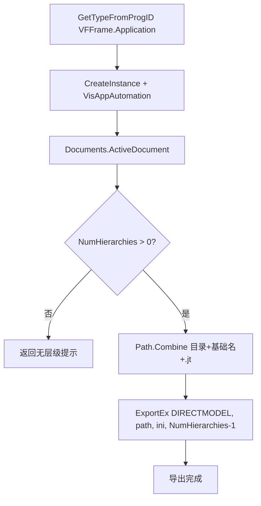

# Skill：导出 CAD（JT）到指定路径（Vismockup C#）

> 技能类型：Vismockup COM 自动化
> 适用场景：把当前活动 Vismockup 文档的数模（模型层级）导出到指定路径，导出 JT 数据。
>          **凡是“导出数据 / 导出模型 / 导出数模 / 保存到指定路径”的指令，都用本文件。**
> 触发关键词：导出、导出数据、导出数模、导出模型、导出到路径、导出到指定目录、export、
>            导出 JT、导出 CAD、保存模型、另存、ExportEx、DIRECTMODEL、JT

## 目标

连接正在运行的 Vismockup（`VFFrame.Application`），获取当前活动文档，把最后一个层级（hierarchy）以 `DIRECTMODEL`（JT）格式导出到 `目标目录\基础文件名.jt`。

## 关键接口与参数

- `Type.GetTypeFromProgID("VFFrame.Application")` → 获取 COM 类型（Vismockup 需已启动）。
- `oOTCVis.VisAppAutomation()` → 返回 `DispVisApp` 自动化对象。
- `gDispVisApp.Documents` → 文档集合 `VisDispDocList`。
- `gDocs.ActiveDocument` → 当前活动文档 `VisDispDoc`。
- `gDoc.NumHierarchies` → 文档中的层级数量。
- `gDoc.ExportEx(saveType, fullPath, iniPath, hierarchyIndex)` → 导出接口：
  - `saveType`：`SAVE_TYPE.DIRECTMODEL`（JT 格式）。
  - `fullPath`：目标 `.jt` 文件的完整路径。
  - `iniPath`：导出配置 `.ini` 文件路径（控制导出选项）。
  - `hierarchyIndex`：要导出的层级索引，`NumHierarchies - 1` 表示最后一个层级。

## C# 代码

```csharp
using System;
using System.IO;
using VISAUTOMATIONLib;

// baseName：导出文件基础名（不含扩展名）
// cojtFolderPath：目标目录
string ExportActiveDocumentToJt(string cojtFolderPath, string baseName, string exportIniPath)
{
    Type oType = Type.GetTypeFromProgID("VFFrame.Application");
    if (oType == null)
    {
        return "Cannot find COM ProgID 'VFFrame.Application'. / 未找到 COM ProgID 'VFFrame.Application'。";
    }

    dynamic oOTCVis = Activator.CreateInstance(oType);
    VISAUTOMATIONLib.DispVisApp gDispVisApp = oOTCVis.VisAppAutomation();
    VisDispDocList gDocs = gDispVisApp.Documents;

    if (gDocs == null || gDocs.ActiveDocument == null)
    {
        return "No active Vismockup document was found. / 未找到当前打开的 Vismockup 文档。";
    }

    VISAUTOMATIONLib.VisDispDoc gDoc = gDocs.ActiveDocument;

    int hierarchyCount = gDoc.NumHierarchies;
    if (hierarchyCount <= 0)
    {
        return "No hierarchy was found in the active Vismockup document. / 当前 Vismockup 文档中没有可导出的层级。";
    }

    // 组合目标路径：目录 + 基础名 + .jt
    string jtFullPath = Path.Combine(cojtFolderPath, baseName + ".jt");

    gDoc.ExportEx(
        SAVE_TYPE.DIRECTMODEL,      // 导出为 JT（DirectModel）
        jtFullPath,                 // 完整目标路径
        exportIniPath,              // 导出配置 ini，例如 "C:\\Users\\YWANG246\\source\\LLM\\EXPORT.ini"
        hierarchyCount - 1);        // 导出最后一个层级

    return $"Exported: {jtFullPath}";
}
```

## 执行流程



## 给代码生成模型的提示

- Vismockup 必须已经运行且有活动文档，否则 `ActiveDocument` 为 `null`。
- 目标路径用 `Path.Combine(folder, baseName + ".jt")` 拼接，避免手写分隔符。
- `ExportEx` 第 4 个参数是**层级索引**（0 基），最后一个层级用 `NumHierarchies - 1`。
- `SAVE_TYPE.DIRECTMODEL` 对应 JT；导出选项由 `.ini` 配置文件决定，需保证该 ini 路径存在。
- 建议在调用前用 `Directory.Exists(cojtFolderPath)` 校验目录，必要时 `Directory.CreateDirectory` 创建。
- 全程使用 `[STAThread]` 的 COM 上下文。
