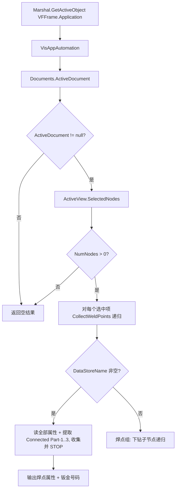

# Skill：输出选中焊点的属性信息并提取板材搭接的钣金号码（Vismockup C#）

> 技能类型：Vismockup COM 自动化
> 适用场景：连接正在运行的 Vismockup，读取当前视图中被选中的焊点（或焊点组）的**全部元数据属性**，
>          并从元数据键 `Connected Part-1 / Connected Part-2 / Connected Part-3` 中提取该焊点
>          **板材搭接（钣金搭接）所连接的钣金件号码**（一个焊点通常连接 2~3 层钣金）。
> 触发关键词：焊点属性、焊点属性信息、输出焊点属性、选中焊点属性、板材搭接、钣金搭接、钣金号码、
>            钣金件号、连接钣金、Connected Part、Connected Part-1、Connected Part-2、Connected Part-3

## 目标

1. **附着**到正在运行的 Vismockup 实例（用户已在其中选好焊点），取当前活动视图的选中节点集合。
2. 选中项可能是**单个焊点**，也可能是**焊点组**（内部节点）；对每个选中项递归向下遍历，找到叶子焊点节点。
3. 对每个焊点节点：
   - 读取并**输出该焊点的全部元数据属性**（键值对）。
   - 从元数据中提取 `Connected Part-1..3`，得到**板材搭接连接的钣金号码**（不存在的层跳过）。

> 说明：
> - 焊点的**位置坐标 / 法向**请用节点 `Transform`（16 元素 4×4 矩阵）转换，见
>   `skill_get_weld_point_location_and_normal.md`；本技能只负责**属性输出 + 钣金号码提取**，不做矩阵→位姿转换。
> - 属性都保存在节点的 `MetaDataProperties` 里。【实测】元数据键常带一个末尾 `::` 后缀（如
>   `Connected Part-1::`、`Owner_Name::`），且大小写/空格可能不一致。因此匹配 `Connected Part-*` 时必须用
>   `StartsWith`/`Contains` 前缀匹配 + `Trim()` + 忽略大小写，**绝不能**用严格相等（严格相等会“N 个节点选中但 0 个提取”）。

## 关键接口与参数

- `Marshal.GetActiveObject("VFFrame.Application")` → **附着**到正在运行的实例（必须，否则取不到选中项）。
- `running.VisAppAutomation()` → `DispVisApp`。
- `gDispVisApp.Documents` → `VisDispDocList`；`gDocs.ActiveDocument` 为 `null` 时说明无活动文档。
- `gDocs.ActiveView.SelectedNodes` → 选中节点集合 `VisDispNodeList`；`NumNodes == 0` 时直接返回。
- `visDispNodeList.Node[i]` → 第 i 个选中节点（可能是单个焊点，也可能是焊点组）。
- `node.Children` / `children.NumNodes` / `children.Node(c)` → 子节点集合，用于递归下钻到叶子焊点。
- `node.MetaDataProperties` → 元数据集合 `VisDispMetaDataList`。
- `metaObj.NumProperties` + `GetProperty(i, out name, out value)` → 逐条读取属性；
  两个 `[out]` 参数是 **VARIANT**，后期绑定**必须用 `VariantWrapper(null)` 包装**，否则抛 `DISP_E_BADCALLEE`，一个属性都读不到。
- 钣金号码键：`Connected Part-1`、`Connected Part-2`、`Connected Part-3`（第 1/2/3 层被连接的钣金件号）。

## C# 代码

```csharp
using System;
using System.Collections.Generic;
using System.Reflection;
using System.Runtime.InteropServices;   // Marshal.GetActiveObject / VariantWrapper

// 一个焊点的输出信息：名称 + 全部属性 + 板材搭接钣金号码。
public class WeldPointProperties
{
    public string Name;                                   // 焊点名称（去掉 _序号 后缀）
    public Dictionary<string, string> AllProperties       // 全部元数据键值对
        = new Dictionary<string, string>();
    public List<string> ConnectedPartNumbers              // 板材搭接的钣金号码（Connected Part-1..3）
        = new List<string>();
}

// 读取当前 Vismockup 选中焊点的属性信息 + 板材搭接钣金号码。
private List<WeldPointProperties> GetSelectedWeldPointPropertiesFromVismockup()
{
    var results = new List<WeldPointProperties>();

    // 连接正在运行、且已经选中焊点的 Vismockup 实例。
    // 实测（VisView_NG 14.3）：VFFrame.Application 是【单实例】本地服务，运行中的 Vismockup
    // 通常【不向 ROT 发布】活动对象，Marshal.GetActiveObject 会抛 MK_E_UNAVAILABLE(0x800401E3)。
    // 此时 Activator.CreateInstance 不会新建空白实例，而是【连接到已运行的那个实例】，
    // 其 ActiveDocument / SelectedNodes 就是用户当前的文档与选中焊点。故 CreateInstance 是可靠回退。
    dynamic gDispVisApp = null;
    try
    {
        dynamic running = Marshal.GetActiveObject("VFFrame.Application");
        gDispVisApp = running.VisAppAutomation();
    }
    catch
    {
        // GetActiveObject 失败（常见：MK_E_UNAVAILABLE）时用 CreateInstance 连接到运行中的单实例。
        Type oType = Type.GetTypeFromProgID("VFFrame.Application");
        if (oType == null) return results;   // 未找到 COM ProgID
        dynamic oOTCVis = Activator.CreateInstance(oType);
        gDispVisApp = oOTCVis.VisAppAutomation();
    }

    dynamic gDocs = gDispVisApp.Documents;
    if (gDocs == null || gDocs.ActiveDocument == null) return results;  // 无活动文档

    dynamic selected = gDocs.ActiveView.SelectedNodes;
    if (selected == null || (int)selected.NumNodes == 0) return results; // 无选中项

    for (int i = 0; i < (int)selected.NumNodes; i++)
        CollectWeldPoints(selected.Node[i], results);

    return results;
}

// 递归下钻：命名节点当焊点读取（成功即收集并 STOP），空名结构节点（焊点组）向下钻。
private void CollectWeldPoints(dynamic node, List<WeldPointProperties> results)
{
    if (node == null) return;

    // 关键判据（VisView_NG 实测）：焊点节点 DataStoreName【非空】（通常以 .jt 结尾，NumProperties ~32）；
    // 焊点组是【未命名/空白】结构节点，不带焊点元数据。必须用“命名节点=焊点”做主判据，
    // 而不是“有元数据=焊点”——后者不稳定：焊点组/几何子节点若恰好带一点元数据就会被误当成一个焊点，
    // 提前 return 从而漏掉真正的 N 个焊点。这正是“选中焊点组时提取错误、不稳定”的根因。
    //   命名节点 => 焊点：读取全部元数据后收集并 STOP（不再下钻其几何子节点）；
    //   空名节点 => 焊点组/装配层级：向下钻。
    string name = null;
    try { name = (string)node.DataStoreName; } catch { name = null; }

    if (name != null && name.Trim().Length > 0)
    {
        WeldPointProperties wp;
        if (TryReadWeldPointProperties(node, out wp))
        {
            results.Add(wp);
            return;   // 已收集该焊点，绝不下钻其几何子节点
        }
        // 命名但无元数据：继续尝试子节点以防万一。
    }

    // 未命名 / 结构节点（焊点组 / 装配层级）：递归遍历子节点。
    int childCount = 0;
    dynamic children = null;
    try { children = node.Children; if (children != null) childCount = (int)children.NumNodes; }
    catch { childCount = 0; }

    for (int c = 0; c < childCount; c++)
        CollectWeldPoints(children.Node(c), results);
}

// 读取单个节点的全部元数据 + 提取 Connected Part-1..3；无元数据视为非焊点节点。
private bool TryReadWeldPointProperties(dynamic node, out WeldPointProperties wp)
{
    wp = null;

    object metaObj;
    try { metaObj = node.MetaDataProperties; } catch { return false; }
    if (metaObj == null) return false;

    int count;
    try { count = (int)((dynamic)metaObj).NumProperties; } catch { return false; }
    if (count <= 0) return false;   // 没有元数据 —— 不是可读的焊点节点

    var result = new WeldPointProperties();

    // 名称：去掉末尾的 _序号 后缀。
    try
    {
        string name = node.DataStoreName;
        result.Name = name.Contains("_") ? name.Substring(0, name.LastIndexOf('_')) : name;
    }
    catch { result.Name = "<unknown>"; }

    int failures = 0;
    string firstError = null;

    for (int i = 0; i < count; i++)
    {
        try
        {
            // 两个 [out] VARIANT 必须用 VariantWrapper(null) 包装，否则 DISP_E_BADCALLEE，读不到任何属性。
            object[] args = { i, null, null };
            var pm = new ParameterModifier(3); pm[1] = true; pm[2] = true;
            metaObj.GetType().InvokeMember("GetProperty", BindingFlags.InvokeMethod,
                null, metaObj, args, new[] { pm }, null, null);

            string key = Convert.ToString(Unwrap(args[1]) ?? "").Trim();
            string val = Convert.ToString(Unwrap(args[2]) ?? "").Trim();
            if (key.Length == 0) continue;

            result.AllProperties[key] = val;

            // 板材搭接钣金号码：Connected Part-1 / -2 / -3（忽略大小写 + 去空格）。
            if ((key.StartsWith("Connected Part-", StringComparison.OrdinalIgnoreCase))
                && val.Length > 0)
            {
                result.ConnectedPartNumbers.Add(val);
            }
        }
        catch (Exception ex)
        {
            // 单项失败不影响其它项，但记录首个异常，供“全部失败”时暴露真实错误信号。
            failures++;
            if (firstError == null) firstError = ex.Message;
        }
    }

    // 一项都没读到、且每项都异常 => 必须让上层看到失败信号，否则 auto-fix 无法触发。
    if (failures == count)
        throw new InvalidOperationException(
            "MetaData GetProperty failed for all " + count + " properties; first error: " + firstError);

    wp = result;
    return true;
}

// 解开 VariantWrapper（[out] VARIANT 常被包一层）。
private static object Unwrap(object o)
{
    var w = o as VariantWrapper;
    return w != null ? w.WrappedObject : o;
}
```

## 输出示例（打印给用户）

```csharp
var welds = GetSelectedWeldPointPropertiesFromVismockup();
if (welds.Count == 0)
{
    Console.WriteLine("未取到选中焊点（请确认 Vismockup 已运行、有活动文档，并已选中焊点）。");
}
foreach (var wp in welds)
{
    Console.WriteLine("焊点: " + wp.Name);
    Console.WriteLine("  === 全部属性 ===");
    foreach (var kv in wp.AllProperties)
        Console.WriteLine("    " + kv.Key + " = " + kv.Value);

    Console.WriteLine("  === 板材搭接钣金号码 ===");
    if (wp.ConnectedPartNumbers.Count == 0)
        Console.WriteLine("    (未找到 Connected Part-1..3)");
    else
        for (int i = 0; i < wp.ConnectedPartNumbers.Count; i++)
            Console.WriteLine("    钣金 " + (i + 1) + ": " + wp.ConnectedPartNumbers[i]);
}
```

## 执行流程



## 给代码生成模型的提示

- 连接 Vismockup：优先 `Marshal.GetActiveObject("VFFrame.Application")`，失败再退回 `Activator.CreateInstance`。
  **实测重点**：`VFFrame.Application` 是【单实例】本地服务，运行中的 Vismockup（VisView_NG）常
  **不向 ROT 发布**活动对象，`GetActiveObject` 会抛 `MK_E_UNAVAILABLE(0x800401E3)`。这属正常现象——
  此时 `Activator.CreateInstance` **不会新建空白实例，而是连接到已运行的那个实例**，`ActiveDocument`/
  `SelectedNodes` 即用户当前文档与选中焊点。故两条路径都要保留，CreateInstance 是可靠回退，不要因它
  “可能新建实例”而删掉。
- 选中项来自 `ActiveView.SelectedNodes`，先判断 `NumNodes == 0` 再遍历；集合索引用 `Node[i]`，
  子节点索引用**方法式** `Node(c)`。
- 选中项可能是单个焊点，也可能是焊点组。区分焊点与焊点组的**唯一可靠判据**是 DataStoreName（实测）：
  【命名节点（DataStoreName 非空，通常 .jt 结尾，NumProperties ~32）= 焊点】，读取其全部元数据后收集并 return，
  绝不下钻其几何子节点；【未命名/空白节点 = 焊点组/装配层级】，向下钻子节点。
  切勿用“有元数据 = 焊点”判定——那不稳定：焊点组/几何子节点若恰好带一点元数据就会被误当成一个焊点、
  提前 return，从而漏掉真正的 N 个焊点。这就是“选中焊点组时提取错误、不稳定”的根因。
- 元数据 `GetProperty` 的两个 `[out]` 参数是 **VARIANT**，后期绑定**必须用 `VariantWrapper(null)` 包装**
  并用 `Unwrap` 取值；直接传 `null`/`string.Empty` 会抛 `DISP_E_BADCALLEE`，一个属性都读不到。
- 钣金号码在元数据键 `Connected Part-1 / -2 / -3` 里（板材搭接的第 1/2/3 层钣金件号）；键常带末尾 `::`
  后缀（如 `Connected Part-1::`），故匹配用 `StartsWith("Connected Part-", OrdinalIgnoreCase)` + `Trim()`，
  对应键不存在表示没有该层（跳过，不报错）。
- 若需要这些钣金的**厚度/材料**，再定位到对应钣金节点读取 `MCI Gauge/Thickness [mm]` 与
  `MCI Material Specification`（见 `04_nodes_metadata.md`）。
- 强制返回值契约：当选中 N 项但每一项元数据都读取失败时，必须 `throw` 暴露首个异常（本技能已用
  `failures`/`firstError` 计数并在全部失败时抛出），顶层应转成 `Success = false`，否则执行期 auto-fix 无法触发。
- 焊点**位置坐标 / 法向**不在本技能范围——用节点 `Transform` 转换，见
  `skill_get_weld_point_location_and_normal.md`。
- 全程使用 `[STAThread]` 的 COM 上下文；工程位数需与 Vismockup 进程一致（通常 x64）。
